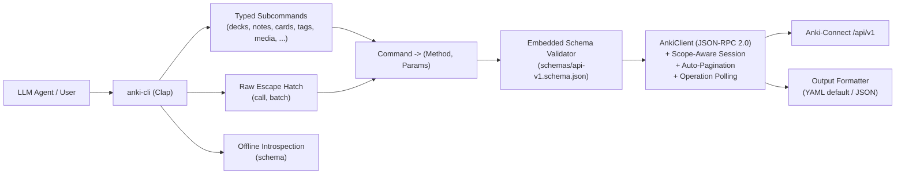
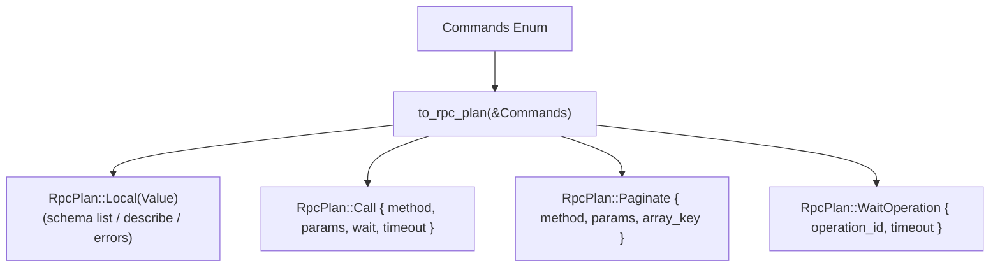

# Implementation Plan: `anki-skill` (`anki-cli`) for Anki-Connect API v1

## Goal Description

Build out `anki-skill` (`anki-cli`) into a complete, tested, LLM-friendly Rust CLI for **Anki-Connect API v1** (`POST /api/v1` JSON-RPC 2.0, backed by [`api-v1.schema.json`](file:///Users/unni/dev/anki-skill/schemas/api-v1.schema.json)):

1. **YAML Output by Default:** Emit clean YAML on `stdout` (and structured YAML error envelopes on `stderr`) by default to minimize LLM token overhead and improve readability, while supporting `--format <yaml|json|json-pretty>` (plus `--json` / `--pretty` convenience flags).
2. **Complete API v1 Coverage (Hybrid Architecture):**
   - **100% API Escape Hatch & Batching:** `call` (single JSON-RPC method with optional local schema validation and automatic `OperationHandle` polling) + `batch` (wrapping `api.execute` and JSON-RPC transport batches) + `schema` (offline introspection of all 96 methods across 21 namespaces).
   - **Ergonomic Typed Subcommands:** Expand first-class subcommands beyond the initial 5 namespaces (`collection`, `decks`, `notes`, `cards`, `operations`) to cover all major agent workflows: `note-types`, `tags`, `media`, `scheduling`, `statistics`, `profiles`, `packages`, and `gui` (`browser`, `editors`, `reviewer`, `application`).
   - **Scope-Aware Session & Schema Validation:** Fix session injection so `session` is only injected into `scope: "collection"` methods (avoiding schema rejections on `scope: "application"` calls such as `operations.get` during polling), and add pre-flight parameter validation against the embedded `api-v1.schema.json`.
3. **Comprehensive Test Suite:**
   - **Unit tests** for output formatting (YAML/JSON), error serialization, and schema `$ref` resolution.
   - **Schema contract tests** verifying that the parameters generated by every CLI subcommand variant conform to the method definitions in `schemas/api-v1.schema.json`.
   - **Mock HTTP server integration tests** covering JSON-RPC envelopes, Bearer authentication, `scope: "collection"` vs `scope: "application"` session handling, cursor auto-pagination, async `OperationHandle` polling/timeout/cancellation, and deterministic exit codes.



---

## User Review Required

> [!IMPORTANT]
> **YAML as Default Output Format**
> `anki-cli` currently outputs compact JSON by default. This plan switches the default output on both `stdout` and `stderr` to **YAML** (`serde_norway` / `serde_yaml`), which is more token-efficient and readable for LLM agents. Scripts or pipelines needing JSON can pass `--format json` (or `-o json` / `--json`).

> [!WARNING]
> **Bug Fix in `AnkiClient` Session Injection**
> Currently, [client.rs](file:///Users/unni/dev/anki-skill/src/client.rs#L182-L195) injects `"session"` into `params` for *every* RPC call when `--session` / `ANKI_CONNECT_SESSION` is set. However, in [`api-v1.schema.json`](file:///Users/unni/dev/anki-skill/schemas/api-v1.schema.json), all 9 `scope: "application"` methods (`operations.get`, `operations.cancel`, `api.describe`, `api.execute`, `profiles.*`, `access.requestPermission`, `application.exit`) specify `additionalProperties: false` and do **not** accept `"session"`. This causes async operation polling (`operations.get`) to fail whenever a session is configured. We will make session injection scope-aware using the embedded schema metadata.

---

## Proposed Changes

### Dependencies & Library Split

Split the crate into a library (`src/lib.rs`) + thin binary (`src/main.rs`) so integration and schema contract tests can directly exercise command-to-RPC translation, validation, and mock server roundtrips.

#### [MODIFY] [Cargo.toml](file:///Users/unni/dev/anki-skill/Cargo.toml)
- Add `serde_norway = "0.9"` (maintained drop-in fork of `serde_yaml`) for YAML serialization and flexible YAML/JSON input parsing on `--params` / `--fields`.
- Add `[lib]` target (`src/lib.rs`) alongside `[[bin]]` (`anki-cli`).
- Add `[dev-dependencies]` for testing:
  - `mockito = "1"` (or `tiny_http` / `httpmock`) for local HTTP JSON-RPC server mocking.
  - `jsonschema = "0.29"` (or recursive draft 2020-12 validator in test suite) to validate generated RPC request envelopes and method params against `schemas/api-v1.schema.json`.
  - `assert_cmd = "2"` and `predicates = "3"` for CLI binary execution and YAML/JSON output assertions.

---

### Core Architecture & Output Formatting

#### [NEW] `src/lib.rs`
- Re-export `client`, `commands`, `error`, `output`, and `schema` modules for use by `src/main.rs` and `tests/`.

#### [NEW] `src/output.rs`
- Define `OutputFormat`:
  ```rust
  #[derive(Clone, Copy, Debug, Default, clap::ValueEnum)]
  pub enum OutputFormat {
      #[default]
      Yaml,
      Json,
      JsonPretty,
  }
  ```
- Implement `format_value(&Value, OutputFormat) -> Result<String, CliError>` and `format_error(&CliError, OutputFormat) -> String`.

#### [MODIFY] [main.rs](file:///Users/unni/dev/anki-skill/src/main.rs)
- Add `--format <yaml|json|json-pretty>` (default `yaml`, short `-f` or `-o`) and keep `--json` / `--pretty` as convenience aliases so existing command examples continue to work.
- Add `--no-validate` global flag to optionally bypass client-side schema validation before sending RPC requests.
- Render both normal outputs (`stdout`) and structured errors (`stderr`) using `OutputFormat` (YAML by default).

---

### Schema Introspection & Client-Side Validation

#### [MODIFY] [schema.rs](file:///Users/unni/dev/anki-skill/src/schema.rs)
- Parse `schemas/api-v1.schema.json` once via `std::sync::LazyLock<Value>`.
- Add helper functions:
  - `method_scope(method: &str) -> Option<&'static str>`: Returns `"collection"` or `"application"` from `x-methods.<method>.scope`.
  - `method_completion(method: &str) -> Option<&'static str>`: Returns `"completed"` or `"operation"`.
  - `validate_method_params(method: &str, params: &Value) -> Result<(), CliError>`: Checks that `method` exists in `x-methods`, required properties in `<method>_Params` are present, unknown properties are rejected when `additionalProperties == false`, and `EntityId` / `Reference` shapes are valid before making a network call.

#### [MODIFY] [client.rs](file:///Users/unni/dev/anki-skill/src/client.rs)
- Make `with_session(method, params)` scope-aware: only inject `"session"` when `schema::method_scope(method) == Some("collection")`.
- Add `batch(&self, requests: Vec<(String, Value)>) -> Result<Value, CliError>` supporting JSON-RPC 2.0 `TransportBatch` and `api.execute` atomic/sequential batches.
- Allow configurable base HTTP timeout and polling interval (so mock tests can test operation polling and timeouts in milliseconds rather than waiting seconds).

---

### Complete Hybrid CLI Subcommands

Refactor `src/commands/mod.rs` to separate **1. building the RPC call specification** (`to_rpc_plan(&Commands) -> Result<RpcPlan, CliError>`) from **2. executing it against `AnkiClient`**. This separation allows our test suite to verify the exact `(method, params)` produced by every CLI flag combination against `schemas/api-v1.schema.json` without needing a live server.



#### [MODIFY] [mod.rs](file:///Users/unni/dev/anki-skill/src/commands/mod.rs) (and modularize into `src/commands/*.rs`)
1. **Escape Hatch & Batching (`call`, `batch`, `schema`, `describe`):**
   - `call <method> [--params <json-or-yaml>] [--stdin] [--no-wait] [--timeout <secs>]`: Parse `--params` or `stdin` as either JSON or YAML (`serde_norway::from_str` is a superset of JSON, so agents can pass either JSON or YAML!).
   - `batch [--file <path> | --stdin] [--mode <execute|transport>] [--no-wait]`: Run multi-step workflows via `api.execute` or JSON-RPC transport batch.
2. **Existing Domains (Enhanced):**
   - `collection`: `get`, `sync`, `refresh`, `check-integrity`, `undo`
   - `decks`: `list`, `get`, `create`, `update`, `delete`, `counts`
   - `notes`: `get`, `get-many`, `search`, `create`, `create-many`, `validate`, `validate-many`, `update`, `delete`, `find-empty`, `plan-conversion`, `convert`
   - `cards`: `get`, `get-many`, `search`, `render`, `move`, `suspend`, `unsuspend`, `flags`
   - `operations`: `get`, `wait`, `cancel`
3. **New First-Class Domains for Complete Coverage:**
   - `note-types`: `list`, `get`, `create`, `update`, `edit-structure`, `template-usage`, `replace-text`, `delete-unused`
   - `tags`: `list`, `add`, `remove`, `replace`, `delete-unused`
   - `media`: `list`, `get`, `store`, `delete`, `directory`
   - `scheduling`: `get`, `queue`, `predict`, `due`, `answer`, `answer-many`, `reposition`, `reset`, `set-due-date`
   - `statistics`: `today`, `review-days`, `summary`, `html`
   - `profiles`: `list`, `active`, `switch`
   - `packages`: `import`, `export`
   - `deck-presets`: `list`, `get`, `create`, `update`, `assign`, `delete`
   - `gui`: `navigate`, `import-file`, `exit`, `browser-open`, `browser-selection`, `browser-select`, `editor-open-note`, `editor-open-add`, `editor-update-draft`, `reviewer-get`, `reviewer-show-question`, `reviewer-show-answer`, `reviewer-answer`, `reviewer-start-timer`, `reviewer-play-audio`

---

### Documentation & Agent Skill Updates

#### [MODIFY] [SKILL.md](file:///Users/unni/dev/anki-skill/SKILL.md) & [README.md](file:///Users/unni/dev/anki-skill/README.md)
- Update documentation to reflect YAML-by-default output (`--format json` when JSON is needed), YAML/JSON input support on `--params` and `--fields`, and the expanded subcommand namespaces.

---

## Verification Plan

### Automated Tests

We will implement three automated test layers runnable via `cargo test`:

1. **Unit Tests (`src/*.rs`):**
   - YAML default formatting vs JSON/pretty JSON formatting (`src/output.rs`).
   - Error exit code mapping (`2` input/schema, `3` HTTP/transport, `4` RPC/operation failure, `5` timeout) and YAML/JSON error formatting (`src/error.rs`).
   - Embedded schema introspection (`list_methods`, `describe_method` `$ref` resolution, `method_scope`, client-side validation errors) (`src/schema.rs`).

2. **Schema Contract Tests (`tests/schema_contract_tests.rs`):**
   - Table-driven tests constructing CLI invocations across every subcommand namespace (`collection`, `decks`, `notes`, `cards`, `note-types`, `tags`, `media`, `scheduling`, `statistics`, `profiles`, `packages`, `deck-presets`, `gui`, `operations`, `call`).
   - Convert each parsed `Commands` via `to_rpc_plan` into its `(method, params)` pair (both with and without `--session` configured).
   - Validate every generated request envelope and `params` object against the corresponding `x-methods.<method>.params` schema in `schemas/api-v1.schema.json`.
   - Verify that all 96 methods in `schemas/api-v1.schema.json` can be invoked and validated via `anki-cli`.

3. **Mock HTTP Server Integration Tests (`tests/mock_http_tests.rs`):**
   - Spin up a local mock HTTP server (`mockito`) and test `AnkiClient` and the `anki-cli` binary end-to-end:
     - Standard request/response in default YAML format and `--format json`.
     - Bearer token header (`--api-key`) verification.
     - Scope-aware `--session` injection: verify `decks.list` receives `"session"` while `operations.get` and `api.describe` do **not**.
     - Cursor auto-pagination (`notes search --all` across 3 mocked pages with `nextCursor`).
     - Async `OperationHandle` lifecycle: initial call returns `{"operationId": "op-1", "method": "collection.sync", "session": "s-1"}`, followed by `running` -> `succeeded` polling on `operations.get`, plus `failed`, `cancelled`, and timeout (`exit code 5`) scenarios.
     - HTTP 401/403 (`exit code 3`) and JSON-RPC error `1003 editorConflict` (`exit code 4`) formatting on `stderr`.

Exact verification commands:
```bash
cargo test --all-targets
cargo clippy --all-targets -- -D warnings
```

### Manual Verification

1. Run offline schema introspection in YAML (default) and JSON:
   ```bash
   cargo run -- schema notes.create
   cargo run -- --format json schema notes.create
   ```
2. If Anki Desktop with Anki-Connect v1 is running locally:
   ```bash
   cargo run -- collection get
   cargo run -- decks list
   ```
